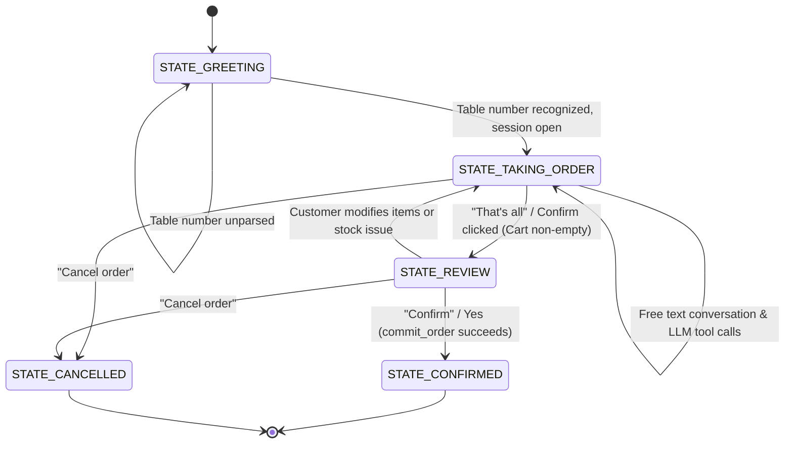

# Perpetual Bistro - AI Virtual Waiter

A self-order kiosk where a virtual waiter takes a customer's order in plain language (typed or spoken). A local LLM (Qwen 2.5 through Ollama) talks to the customer and calls SQLite tools; plain Python decides everything that involves money, stock, and state, ensuring financial and inventory data are never hallucinated. A web dashboard features the kiosk, a live dining-room floor map, and a PIN-protected manager mode.

**Sole Developer & Architect:** John Benedict G. Andaya  
**Project Type:** Solo Capstone / Full-Stack AI Application  
**Working Directory:** `D:\SCHOOL\3RD YEAR 1ST SEM\AIlesson6`

---

## 1. File & Folder Structure

All core application files, templates, scripts, and configuration assets sit together within the main project directory:

```
AIlesson6/
├── dashboard_app.py               # Main Flask application server & API router
├── fsm_agent.py                   # Finite State Machine controller & LLM tool loop
├── db_tools.py                    # SQLite CRUD engine & atomic financial logic
├── local_voice.py                 # Offline speech processing (Vosk STT & pyttsx3 TTS)
├── init_restaurant_db.sql         # SQL schema & initial seed data (menu, stock, aliases)
├── virtual_waiter_prototype.py    # Command-line interactive prototype (no Web UI)
├── floor_plan.py                  # Live floor-map backend blueprint & demo generator
├── floor_plan.js                  # Frontend floor map rendering engine
├── manager.py                     # PIN-protected manager backend blueprint & demo generator
├── manager.js                     # Frontend management dashboard interface
├── dashboard.html                 # Kiosk SPA web page (loads floor_plan.js and manager.js)
├── requirements.txt               # Dependencies list (Flask, Ollama, Vosk, pyttsx3, etc.)
├── restaurant.db                  # SQLite database (auto-generated by dashboard_app.py)
├── sample_conversation_log.json   # Log file generated automatically upon completed orders
├── fonts/                         # Font assets directory (.woff2 font files)
├── images/                        # Menu photo storage (auto-created on first launch)
└── model/                         # Vosk offline speech recognition model folder
```

---

## 2. Architecture & Design Principles

```
 Customer (Typing / Buttons / Voice)
        │
        ▼
 ┌───────────────────────────┐   HTTP/JSON   ┌────────────────────────────────────────────┐
 │ Web UI (dashboard.html)   │ ───────────► │ dashboard_app.py (Flask)                   │
 │  floor_plan.js, manager.js│ ◄─────────── │  /api/chat /api/cart /api/confirm /api/... │
 └───────────────────────────┘              └───────┬───────────────────────┬────────────┘
                                                    │                       │
                                      ┌─────────────▼───────────┐   ┌───────▼────────────┐
                                      │ fsm_agent.py            │   │ local_voice.py     │
                                      │  WaiterAgent (FSM)      │   │  Vosk STT (mic)    │
                                      │  + LLM tool loop        │   │  pyttsx3 TTS       │
                                      └──────┬───────────┬──────┘   └────────────────────┘
                                             │           │ chat + tool schemas
                                             │           ▼
                                             │  Ollama (qwen2.5)
                                             ▼
                                      ┌─────────────────────────┐
                                      │ db_tools.py             │──► restaurant.db (SQLite)
                                      │  menu, allergens, cart, │    created from init_restaurant_db.sql
                                      │  commit_order (atomic)  │
                                      └─────────────────────────┘
```

### Key Technical Decisions
* **Deterministic Financial Control:** Python logic exclusively handles total calculations, service fees, table assignment, and checkout. The LLM is active only during order taking (`STATE_TAKING_ORDER`).
* **Session ID Injection:** `session_id` is supplied internally by code to prevent the model from cross-writing to other tables' carts.
* **Context Grounding:** Active cart state is re-injected into the LLM system prompt on every turn.
* **Resilient Tool Return Pattern:** Tools return structured status dicts `{"ok": false, "error": ...}` instead of raising exceptions.
* **Atomic Checkout:** Inventory decrements only during order confirmation inside an isolated SQLite transaction (`commit_order`).
* **Deterministic Regex Fallback:** If the local model misses a clear tool call during an order attempt, a rule-based parser applies the change and marks the transaction `rule_fallback`.
* **Decoupled Audio Pipeline:** `local_voice.py` runs independently via callback handles, allowing full web fallback typing when Vosk or pyttsx3 are uninstalled.

### Callable LLM Tools (`db_tools.py`)
* `get_menu_by_category(category)`: Retrieve menu items with prices, stock levels, and allergen indicators.
* `check_item_allergen(item_id, allergen)`: Query item ingredient profiles against customer dietary constraints.
* `add_item_to_order(item_name, qty, instructions)`: Add item line to order tab (fuzzy matching & alias support).
* `remove_item_from_order(item_name, qty)`: Adjust or remove line items from active order.
* `view_current_order()`: Fetch structured tab details with subtotal, 10% service fee, and grand total.

---

## 3. State Machine Architecture



| State | Purpose | Decision Driver |
| ----- | ------- | --------------- |
| `STATE_GREETING` | Table number selection and session setup | Python (Regex & isolated numbers) |
| `STATE_TAKING_ORDER` | Conversational menu guidance & item management | Local LLM + Tools (Python Regex Fallback) |
| `STATE_REVIEW` | Invoice display and final confirmation prompt | Python |
| `STATE_CONFIRMED` | Atomic database commit, stock deduction, receipt issuance | Python (`commit_order`) |
| `STATE_CANCELLED` | Abort session, zero stock changes | Python |

---

## 4. Environment Setup & Execution Guide (Windows CMD)

### First-Time Setup
```cmd
:: 1. Navigate to project directory
cd /d "D:\SCHOOL\3RD YEAR 1ST SEM\AIlesson6"

:: 2. Create and activate virtual environment
python -m venv venv
venv\Scripts\activate
python floor_plan.py --demo
python manager.py --demo

:: 3. Install dependencies
python -m pip install -r requirements.txt
```

### Model Initialization (Ollama)
```cmd
:: Pull default model (recommended)
ollama pull qwen2.5

:: Pull lightweight model option
ollama pull qwen2.5:1.5b

:: List local models
ollama list

:: Launch Ollama service (if background application is not running)
ollama serve
```

### Running the Web Dashboard (Kiosk, Floor Map, Manager Portal)
```cmd
:: Standard start (runs on http://localhost:5000)
python dashboard_app.py

:: Run using lightweight model
python dashboard_app.py --model qwen2.5:1.5b

:: Run on custom port
python dashboard_app.py --port 8000

:: Wipe database and restore original menu/stock
python dashboard_app.py --reset-db

:: Specify custom Vosk speech model directory
python dashboard_app.py --vosk-model "D:\path\to\model"
```
* Access Kiosk SPA: `http://localhost:5000`
* Access Floor Map directly: `http://localhost:5000/#floor`
* Access Manager Mode directly: `http://localhost:5000/#manager` (Default PIN: `1234`)
* *Note: Refresh browser with `Ctrl+Shift+R` after updating frontend files.*

### Demo Data Setup (For Presentations)
Run once after `dashboard_app.py` has initialized `restaurant.db`:
```cmd
python floor_plan.py --demo
python manager.py --demo
```
*Fills floor plan maps, historical sales data, sample staff profiles, and active dining orders.*

### CLI Prototype Mode (Terminal Execution)
```cmd
python virtual_waiter_prototype.py
python virtual_waiter_prototype.py --model qwen2.5:1.5b --reset-db --log mylog.json
```
*(Type `quit` to exit CLI mode).*

### Daily Usage Workflow
```cmd
cd /d "D:\SCHOOL\3RD YEAR 1ST SEM\AIlesson6"
venv\Scripts\activate
python python_app.py

:: Deactivate virtual environment when done
deactivate
```

---

## 5. Comprehensive Solo Development Log

**Developer & Architect:** John Benedict G. Andaya (100% Solo Contribution)

### Development Responsibility Matrix

| Subsystem | Developer | Tasks Completed |
| --------- | --------- | --------------- |
| **Database Architecture** | John Benedict G. Andaya | Created `init_restaurant_db.sql`, configured auto-versioning via `PRAGMA user_version`, menu alias triggers, and atomic transaction methods in `db_tools.py`. |
| **Agent & FSM Engine** | John Benedict G. Andaya | Authored `fsm_agent.py`, system prompt context managers, Ollama tool schemas, cart context re-injection engine, and rule-based fallback ordering logic. |
| **Backend & Voice API** | John Benedict G. Andaya | Implemented `dashboard_app.py`, Flask web routes, floor plan & manager blueprints (`floor_plan.py`, `manager.py`), and decoupled Vosk/pyttsx3 wrappers in `local_voice.py`. |
| **Web Frontend SPA** | John Benedict G. Andaya | Designed kiosk interface layout (`dashboard.html`), live floor map renderer (`floor_plan.js`), and PIN-protected admin board (`manager.js`). |
| **Testing & Verification** | John Benedict G. Andaya | Performed LLM hallucination mitigation, cross-table security isolation checks, CLI prototype validation, and offline voice input handling. |

### Problems Solved Independently
1. **Local LLM Tool-Calling Drift:** Resolved by tuning system prompts with few-shot tool examples and pairing them with a deterministic regex fallback parser.
2. **Table Number Confusion:** Implemented regex strictness ensuring bare numbers are interpreted as table IDs only when sent as single, standalone numerical messages (preventing "2 burgers" from being misread as Table 2).
3. **Session Security Isolation:** Abstracted all database session handles away from LLM schemas to eliminate the risk of cross-table cart corruption.